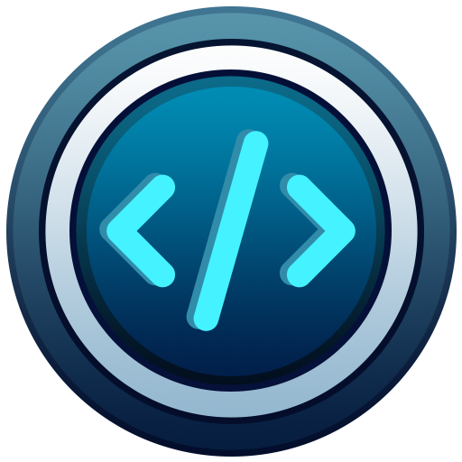

# 👨‍💻 Mahmoud Mostafa Saber | Full-Stack Software Engineer Portfolio

<div align="center">
  
  <h3>Full-Stack Software Engineer | React, Node.js & AI Solutions</h3>
  <p>Building high-performance, accessible, and scalable digital experiences.</p>

  <p>
    <a href="https://mahmoud-mostafa.pages.dev/" target="_blank"><strong>🚀 Live Demo</strong></a> •
    <a href="https://drive.google.com/file/d/1zlTxNe_UTien-WYGGOim7mCgaor4Drzk/view?usp=sharing" target="_blank"><strong>📄 View Resume / CV</strong></a> •
    <a href="https://linkedin.com/in/mahmoud-mostafa-saber" target="_blank"><strong>💼 LinkedIn</strong></a> •
    <a href="https://github.com/MahmoudMosTafa717" target="_blank"><strong>💻 GitHub</strong></a>
  </p>
</div>

---

## 📖 Overview

This repository hosts the source code for the personal portfolio of **Mahmoud Mostafa Saber**, a Computer Science graduate (2025) and graduate of the prestigious **Information Technology Institute (ITI)** 9-Month Professional Diploma (Web & UI Development Track at Smart Village).

The portfolio is engineered with modern frontend best practices: **Core Web Vitals budgets**, accessible ARIA standards, self-hosted web fonts, WebP asset optimization, code splitting, and an interactive **Double-Bezel design system** with smooth 3D tilt effects.

---

## ✨ Key Features & Sections

- **Hero & Interactive CV Modal**: Review the curriculum vitae directly inside the application via an embedded modal, or open/download the latest Google Drive PDF.
- **About Me & Dynamic Stats**: Animated counters showcasing experience, technologies, and certifications.
- **Skills Matrix**: Categorized tech stack covering Frontend, State Management, Backend & Databases, Agentic AI & LLMs, and Software Engineering principles.
- **Featured Projects**: Showcase of full-stack and AI-driven applications with live demos, code repositories, tags, and video demonstrations (Draya LMS, Naqla Recruiter, DiagnoTech, FinTracker, ShopWave).
- **Experience & Education Timeline**: Interactive chronological timeline highlighting ITI diploma, EELU honors degree, and backend/teaching roles.
- **Licenses & Certifications (New)**:
  - **EF SET English Certificate**: C2 Proficient (85/100) in Reading and Listening Mastery.
  - **SmallTalk English Speaking Level Test**: C1+ Advanced spoken English and conversation fluency with direct online verification link.
  - Interactive Lightbox preview modal allowing full-screen inspection and high-res downloads.
- **Fluid Micro-Interactions**: Hardware-accelerated custom cursor (`translate3d`), fluid spring transitions (Emil Kowalski curve presets), and 3D card perspective tilt.
- **Dark / Light Mode**: Smooth theme toggling with theme persistence.
- **Working Contact Section**: Integrated with Web3Forms and EmailJS for seamless direct messaging.

---

## ⚡ Core Web Vitals & Performance Engineering

This site has been optimized following the **`/frontend-lighthouse`** and **`/pagespeed-enhancer`** methodologies:

| Metric / Audit | Baseline / Issue | Optimization Applied | Result / Impact |
| --- | --- | --- | --- |
| **Image Payloads** | 2,776 KiB (uncompressed PNGs) | Converted all project & certificate images to WebP (q=82-85) with `<picture>` fallbacks | **> 90% byte reduction** (~239 KiB total) |
| **Font Delivery** | Chained requests to `cdn.jsdelivr.net` with 24h cache | Self-hosted Geist fonts locally in `public/fonts/` with `<link rel="preload">` in `<head>` | **Zero external font requests**, no FOIT, immutable 1-year cache |
| **JavaScript Chunking** | Single 308 KiB bundle | Rollup manual chunking splitting React core and Framer Motion | **Main bundle reduced to 53 KiB** (82% smaller entry chunk) |
| **Content Security Policy** | Blocked Cloudflare analytics beacon console error | Whitelisted `https://static.cloudflareinsights.com` & `https://cloudflareinsights.com` | **Zero console errors**, 100 Best Practices score |
| **Accessibility (a11y)** | SVG icon with `role="img"` missing alternative text | Added explicit `aria-label` and `title` attributes to all SVG social links | **100% Accessibility pass** & well-formed agent accessibility tree |
| **Forced Reflows** | `getBoundingClientRect()` called on every mouse move in 3D tilt | Geometry caching on pointer enter + GPU `translate3d` transform updates | **Eliminated layout thrashing**, silky 60+ FPS animations |
| **AI Agent Readiness** | Missing `llms.txt` and `ai-catalog.json` | Added standard `llms.txt` (H1, metadata, links) and valid ARD schema manifest | Full compliance with autonomous AI agent discovery protocols |

---

## 🛠️ Tech Stack & Architecture

- **Core**: React 18, React DOM, React Router DOM
- **Build Tool**: Vite 5 + Rollup
- **Styling**: Tailwind CSS v4 (`@tailwindcss/vite`)
- **Typography**: Local self-hosted Geist Sans WOFF2
- **Animation**: Framer Motion (spring kinematics & gesture tracking)
- **Icons**: Lucide React, React Icons (`fa6`, `si`, `vsc`)
- **Hosting**: Cloudflare Pages with custom HTTP `_headers` and CSP policies
- **CI/CD Quality Gate**: Lighthouse CI (`@lhci/cli`) with Core Web Vitals budgets in `lighthouserc.cjs`

---

## 📂 Project Structure

```text
My-Portifolio-main/
├── .github/workflows/
│   └── lighthouse.yml         # CI PR quality gate (Core Web Vitals budgets)
├── public/
│   ├── _headers               # Cloudflare Pages security & caching headers
│   ├── ai-catalog.json        # Agentic Resource Discovery (ARD) catalog
│   ├── llms.txt               # Machine-readable portfolio documentation
│   ├── fonts/                 # Self-hosted Geist Sans WOFF2 fonts
│   ├── images/
│   │   ├── Certificates/      # High-res & WebP certificate images
│   │   └── projects/          # Optimized WebP & PNG project screenshots
│   ├── circle-logo.png
│   └── manifest.json
├── src/
│   ├── assets/                # Global assets
│   ├── components/
│   │   ├── ui/
│   │   │   └── TiltCard3D.jsx # Double-bezel 3D tilt with reflow caching
│   │   ├── About.jsx
│   │   ├── Certificates.jsx   # Licenses & Certifications with modal preview
│   │   ├── Contact.jsx
│   │   ├── CustomCursor.jsx   # GPU-accelerated smooth trailing cursor
│   │   ├── CvModal.jsx        # Embedded CV viewer & download portal
│   │   ├── Experience.jsx     # Experience & Education timeline
│   │   ├── Footer.jsx         # Accessible brand links
│   │   ├── Hero.jsx           # Interactive typewriter hero
│   │   ├── Navbar.jsx         # Responsive island nav & scrollspy
│   │   ├── Projects.jsx       # Featured projects grid with lazy-loaded media
│   │   ├── Skills.jsx         # Categorized skills matrix
│   │   ├── ThemeToggle.jsx    # Dark/Light mode switcher
│   │   └── VideoModal.jsx     # Video demonstration player
│   ├── data/
│   │   └── portfolioData.js   # Single source of truth for portfolio content
│   ├── App.jsx
│   ├── index.css              # Tailwind v4 theme, double-bezel, and fonts
│   └── index.jsx
├── lighthouserc.cjs           # Lighthouse CI configuration & budgets
├── vite.config.js             # Vite build configuration with manualChunks
└── package.json
```

---

## 🚀 Getting Started

### Prerequisites

- Node.js (v18.x or v20.x recommended)
- npm or pnpm

### Installation

1. **Clone the repository**:
   ```bash
   git clone https://github.com/MahmoudMosTafa717/My-Portifolio.git
   cd My-Portifolio
   ```

2. **Install dependencies**:
   ```bash
   npm install
   ```

3. **Configure Environment Variables**:
   Create a `.env` file in the root directory (refer to `.env.example`):
   ```env
   VITE_WEB3FORMS_ACCESS_KEY=your_web3forms_key_here
   ```

4. **Start the development server**:
   ```bash
   npm run dev
   ```

5. **Build for production**:
   ```bash
   npm run build
   ```

6. **Preview the production build**:
   ```bash
   npm run preview
   ```

7. **Run Lighthouse CI locally**:
   ```bash
   npm run lhci
   ```

---

## 📬 Contact & Connect

- **Portfolio**: [mahmoud-mostafa.pages.dev](https://mahmoud-mostafa.pages.dev/)
- **Email**: [mhmodmostafa127@gmail.com](mailto:mhmodmostafa127@gmail.com)
- **LinkedIn**: [linkedin.com/in/mahmoud-mostafa-saber](https://linkedin.com/in/mahmoud-mostafa-saber)
- **GitHub**: [github.com/MahmoudMosTafa717](https://github.com/MahmoudMosTafa717)
- **Phone**: (+20) 106 159 8031

---

<p align="center">Crafted with ❤️ by <strong>Mahmoud Mostafa Saber</strong></p>
